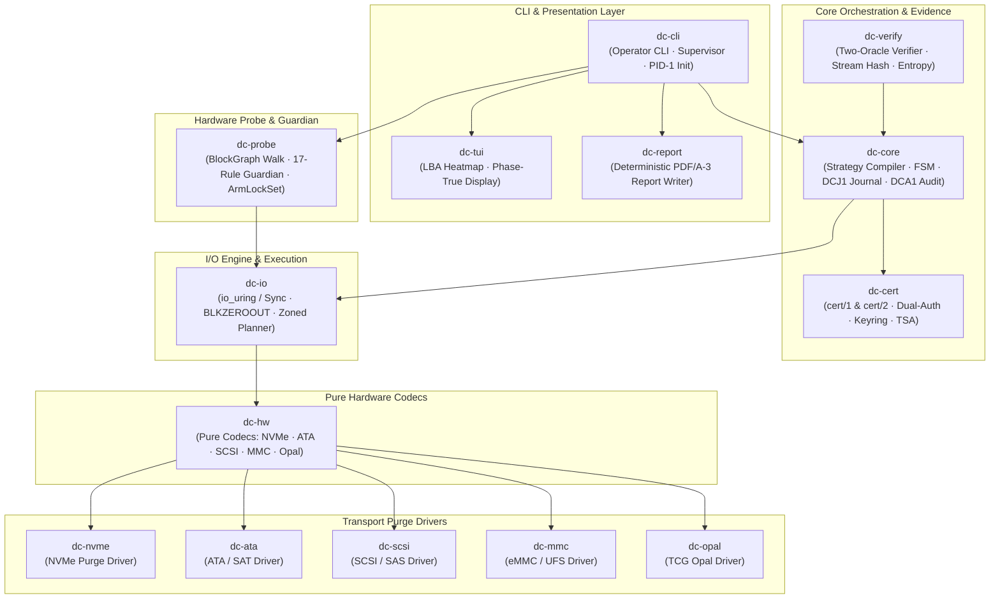
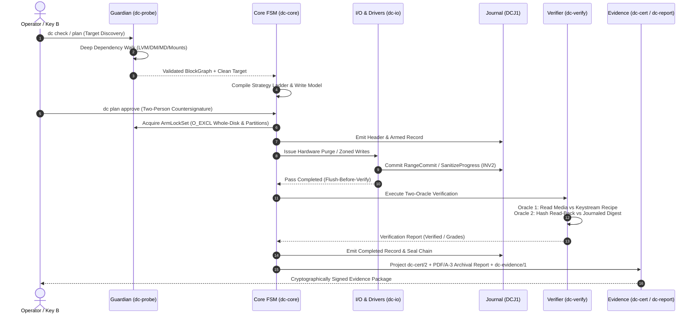
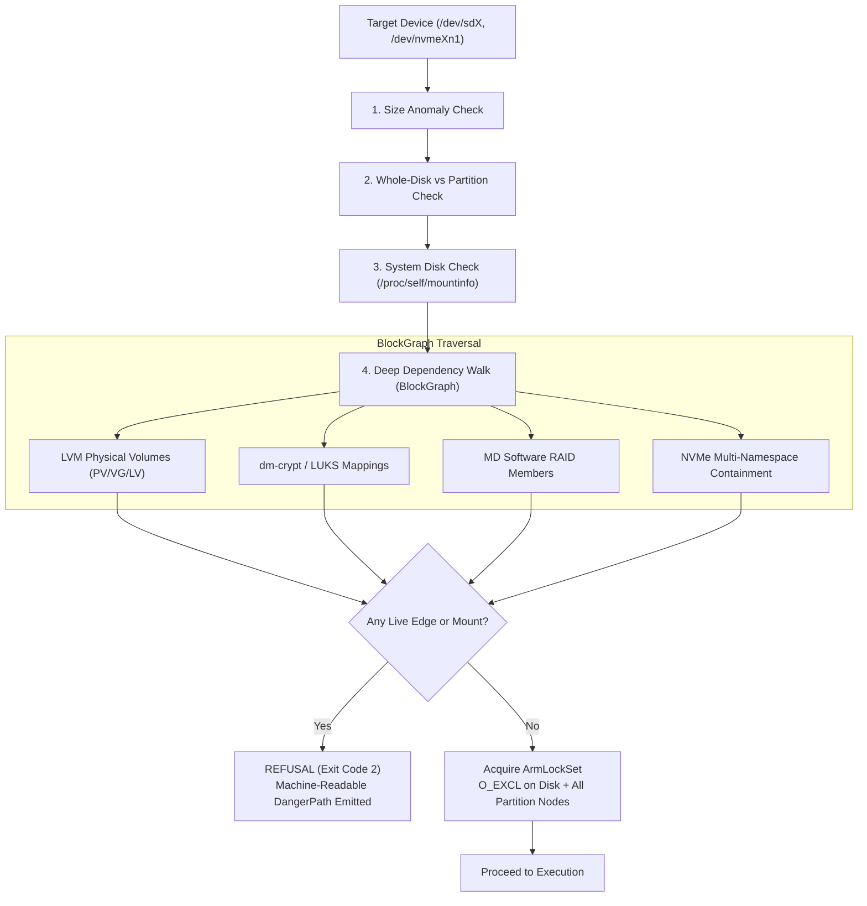
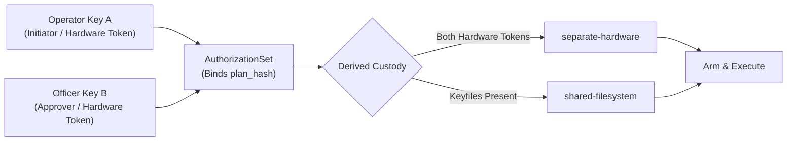
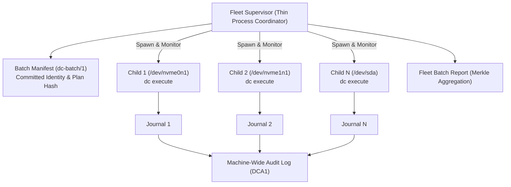

# diskCleaner (`dc`)

[](https://github.com/zephyr4289/discCleaner)
[](LICENSE)
[](https://github.com/zephyr4289/discCleaner)
[](diskCleaner.md)
[](https://github.com/zephyr4289/discCleaner)

**Forensic-grade storage sanitization for Linux — every claim carries its own evidence, verification instructions, and cryptographic proof.**

`dc` is a self-contained, statically linked, zero-dependency storage sanitization suite engineered for NVMe, SATA, SAS/SCSI, USB-bridged (SAT), eMMC/UFS, TCG Opal self-encrypting (SED), and Host-Managed SMR/ZNS storage. It executes **NIST SP 800-88 Rev 1** Clear and Purge operations, issuing cryptographically signed, third-party-verifiable evidence packages that survive crashes, power loss, and adversarial cross-examination.

```
Version       : v0.10.0 (Operator Dashboard · AWS EBS cloud lifecycle w/ hybrid-signed receipts · ML-DSA-44 post-quantum audit signatures)
Target Triples: x86_64-unknown-linux-musl · aarch64-unknown-linux-musl
Runtime Deps  : Zero external binaries, zero dynamic libraries
Crates        : 22 modular workspace crates
Tests         : 150+ unit tests + 60 integration suites + pinned regression guards + cargo-fuzz harnesses + proptest property matrices
Test Driver   : python3 tests/run_tests.py (lit-style discovery, parallel, PASS/FAIL/UNSUPPORTED)
Verification  : Ed25519+ML-DSA-44 hybrid + RFC 8785 JCS + RFC 3161 TSA + PDF/A-3 Archival Embedding + TPM 2.0 quotes
```

---

## Table of Contents

- [Architectural Overview](#architectural-overview)
- [Data Flow & Lifecycle Model](#data-flow--lifecycle-model)
- [Device Support & Sanitization Matrix](#device-support--sanitization-matrix)
- [Quick Start](#quick-start)
- [The Guardian Safety System](#the-guardian-safety-system)
- [Cryptographic Evidence & Offline Verification](#cryptographic-evidence--offline-verification)
- [Two-Person Integrity & Key Lifecycle](#two-person-integrity--key-lifecycle)
- [Fleet Orchestration](#fleet-orchestration)
- [Operator Dashboard (v0.10.0)](#operator-dashboard-v0100)
- [Cloud Block-Storage Lifecycle (v0.10.0)](#cloud-block-storage-lifecycle-v0100)
- [Post-Quantum Audit Signatures (v0.10.0)](#post-quantum-audit-signatures-v0100)
- [Standalone Boot Environment](#standalone-boot-environment)
- [Engineering Discipline & Testkit](#engineering-discipline--testkit)
- [Standards & Compliance](#standards--compliance)

---

## Architectural Overview

`diskCleaner` is organized into 15 modular Rust crates with strict unidirectional dependency boundaries. Unsafe code is strictly isolated to low-level ioctl wrappers; all protocol codecs, parsers, and strategy planners are pure, memory-safe, and deterministic.



---

## Data Flow & Lifecycle Model

Every sanitization run transitions through a deterministic, crash-resilient lifecycle. Execution state is committed to a hash-chained binary journal (`DCJ1`) before issuing media writes.



---

## Device Support & Sanitization Matrix

| Device Class | Primary Firmware Purge | Secondary Fallback | Clear Overwrite | NIST SP 800-88 Grade |
| :--- | :--- | :--- | :--- | :--- |
| **NVMe SSD** | Sanitize Crypto Erase / Block Erase | Format NVM (CES / SES) | `ChaCha20WindowV1` / Zero | **Purge** / Clear |
| **SATA SSD** | ATA Sanitize Crypto Scramble | Enhanced Security Erase | `ChaCha20WindowV1` / Zero | **Purge** / Clear |
| **SATA HDD** | Enhanced Security Erase (DCO/HPA restored) | Security Erase | Multi-Pass DoD / Overwrite | **Purge** / Clear |
| **SAS / SCSI** | SCSI SANITIZE (Crypto / Block) | FORMAT UNIT (Format-Grade) | `ChaCha20WindowV1` / Zero | **Purge** / Clear |
| **USB-Bridged** | SAT Pass-Through (Runtime Probed) | Capability-Probed Overwrite | Verified Logical Overwrite | **Purge** / Clear |
| **eMMC / UFS** | Native Sanitize / Secure Purge | Secure Trim / Trim Erase | User Area Overwrite (RPMB Gated)| **Purge** / Clear |
| **Locked SED** | TCG Opal 2.0 PSID Crypt-Revert | Factory Revert | N/A (PSID unlocks unreadable media)| **Purge** |
| **SMR / ZNS** | Zoned Sequential Discipline + Resets | Zone-Attested Coverage | Sequential Stream Overwrite | **Purge** / Clear |

---

## Quick Start

### 1. Build the Static Binary
```bash
# Clean musl static build (no dynamic dependencies)
cargo build --release --target x86_64-unknown-linux-musl
```

### 2. Reconnaissance & Safety Audit
```bash
# List all system block devices with advisory classification
dc list

# Check target safety against the 17-precedence Guardian (Read-Only)
dc check --target /dev/nvme0n1
```

### 3. Strategy Compilation
```bash
# Compile a deterministic sanitization plan committed by plan_hash
dc plan --target /dev/nvme0n1 --strategy purge --out plan.json
```

### 4. Two-Person Approval & Execution
```bash
# Second operator countersigns the plan (Pre-Arm Dual-Auth)
dc plan approve --plan plan.json --key /path/to/officer.key --out plan.approved.json

# Execute with operator key and interactive serial confirmation
dc execute --plan plan.approved.json --key /path/to/operator.key
```

### 5. Crash Recovery & Resumption
```bash
# Resume an interrupted wipe across crashes, power loss, or reboots
dc resume --journal /var/log/dc/run.dcj
```

### 6. Evidence Inspection & Verification
```bash
# Offline verification of signed certificate and journal chain
dc cert verify cert.json --journal run.dcj

# Generate deterministic archival PDF/A-3 report with embedded JSON
dc report --cert cert.json --out report.pdf
```

### 7. Fleet-Grade Operations (v0.5.0)
```bash
# Full sanitization standards catalog (tender/procurement reference)
dc profiles

# Parallel multi-device wipe: N devices, one command, one all-or-nothing
# precheck, one token confirmation, one summary — per-device journal+cert
dc execute --target /dev/sda --target /dev/sdb --target /dev/nvme0n1 \
           --profile certin-goi --verify sample:64

# Bake-off evidence: production-engine throughput + per-profile ETA table
dc bench --file /scratch/bench.raw --size-mib 2048 --ref-gib 4000
```

### 12. TPM 2.0 PCR Remote Attestation — `dc quote` (v0.8.0, Vector 1)

An Ed25519-signed certificate proves the *operator* approved the wipe — it says nothing about the *host*. A ring-0 rootkit can shim the wipe engine, forge the read-back verifier, and certify a wipe that never happened. `dc quote` closes that gap with the platform's own secure element: a native, zero-dependency TPM 2.0 wire stack (`dc-tpm`, no tpm2-tss, no tpm2-tools, no OpenSSL) that speaks the Part 1/2/3 command set byte-exactly over the kernel resource manager `/dev/tpmrm0` with poll(2) deadline discipline. The appliance measures its kernel into PCR 8, initramfs into PCR 9, the running `dc` binary into PCR 10 and the run evidence into PCR 11 (platform firmware owns PCRs 0-7 via UEFI SRTM), then requests a **TPM2_Quote over PCRs 0-11** signed by a non-exportable NIST P-256 AIK (`CreatePrimary` with RESTRICTED|SIGN|FIXED_TPM|FIXED_PARENT attributes — pinned and verified on every provisioning). The bundle binds a caller nonce (freshness), the TPM monotonic clock (replay guard) and the full PCR digest; it is verified locally before it is ever certified — magic/type/nonce/selection checks, PCR digest recomputation from live `TPM2_PCR_Read`, and ECDSA-P256 signature verification against the AIK public point — and the **raw quote response rides the certificate** so any external auditor can replay the identical verification offline. Hardware-drives-firmware attacks now face the motherboard itself.

### 13. Micro-KVM "Vault Mode" — Encrypted Memory Enclave (v0.8.0, Vector 2)

`dc purge --vault` and `dc execute --vault` isolate the security-critical path inside a **self-contained micro-hypervisor** (~700 lines of pure Rust — no BIOS, no QEMU, no device model): `/dev/kvm` is opened with the frozen API-v12 handshake, guest RAM is mlock'd and never swapped, 1-GiB-identity long-mode page tables + a two-segment GDT are laid down, and the vCPU enters 64-bit mode directly at a 64-byte, BLAKE3-measured guest payload that derives the session key from in-guest RDRAND plus host-injected entropy. Under AMD SEV / SEV-ES / SW-protected VM types (probed by actually attempting the encrypted VM create — the strict `--vault-encrypted-required` posture REFUSES to certify on hosts without memory encryption, never silently downgrading) the guest's working set is ciphertext to the host: a rootkit with hypervisor access cannot read the session key. The read-back verification evidence is then folded into an **HMAC-SHA256 chain keyed by the vault session key** (`chain[n] = HMAC(key, chain[n-1] ‖ record[n])`) whose head rides the certificate: a host rootkit can alter records, but it cannot forge the chain head without the guest-only key, and it cannot replay the head because its altered records cannot reproduce it. The guest image's machine code is pinned by native-execution tests — the same 64 bytes run on the real CPU in CI (REX/SIB encodings included), so no encoding drift can survive. VFIO group-attach plumbing (container SET + KVM_DEV_VFIO_GROUP_ADD) is staged for the v0.9.0 guest-side block driver.

### 14. Photon Bridge — Optical Air-Gap Evidence Exfiltration (v0.8.0, Vector 3)

The highest-classification facilities forbid plugging *anything* into a machine that touched classified data — yet the signed certificate, TPM quote and audit journal must leave the room for command review. `dc photon stream certificate.cert.json` renders an **endless animated stream of fountain-coded QR frames** directly in the terminal: an auditor holds an approved scanning device up to the screen and captures evidence purely via photons — nothing physical ever crosses the SCIF boundary. The payload is split into blocks and **LT fountain-coded** (systematic-first: the k source blocks stream as-is, then a robust-soliton fountain tail repairs any frames the capture missed — order-independent, retransmission-free), each frame batching several symbols plus a stream-identity header (BLAKE3-truncated) inside a pure-Rust QR encoder (byte mode, ECC level M, versions 1-10, full 8-mask penalty selection, BCH format info, RS over GF(256) — every byte-pinned by structure tests). The receiving side reassembles from any sufficient subset of frames and verifies the payload BLAKE3 end-to-end (`dc photon decode`); the certificate embeds the photon manifest (payload hash, stream id, seed, geometry) so the capture session is provably bound to what was signed. Half-block terminal rendering works over serial consoles and SCIF KVM carts; an experimental color-matrix mode doubles density for capture hardware that understands the 4-color cell mapping.

### 15. Enterprise SAN / NVMe-over-Fabrics Remote Purge (v0.8.0, Vector 4)

Government datacenters decommission multi-petabyte SANs, not just local drives. `dc purge --target nvme+tcp://10.0.0.5:4420/nqn.2014-08.org.example:sub1` (also `nvme+rdma://`, `nvme+fc://`, `nvme+loop://`) drives the kernel's fabric host stack **directly over generic netlink** — no libnvme, no nvme-cli: the family id is resolved through the nlctrl GETFAMILY dance, `NVME_CMD_CONNECT` is marshaled byte-exactly with the pinned NVMF attribute set (TRANSPORT/TRADDR/TRSVCID/NQN/HOST_TRADDR/KATO), and the new controller is awaited in `/sys/class/nvme` under a hard appearance deadline. The remote namespace then purges through the SAME controller-attested ladder (in-band Sanitize/Format admin commands over the fabrics controller), after which `NVME_CMD_DISCONNECT` always fires — including on failure — and the certificate records the full fabric session (transport, addresses, NQN, controller, connect/disconnect timestamps, clean-disconnect verdict). `dc fabrics discover` walks the discovery NQN and decodes the LID 0x70 log; `dc fabrics connect/disconnect/list` manage sessions; FC topology evidence (local HBA WWPNs, remote ports) is read from sysfs into the certificate. Every step is deadline-guarded — a wedged fabric fails the purge in seconds, never hangs a lights-out run.

### 16. Memory-Security Hardening: Zeroization + mlock + TPM-Sealed Keys (v0.9.0, Phase 1)

Every secret that transits `dc` userspace now lives inside a **`dc-core::secrets::SecretBuf`** — a heap guard that `mlock(2)`-pins its pages for its lifetime (private keys can never be paged out to swap where they would outlive the run) and wipes them with volatile stores on drop (the audited `zeroize` crate; compiler-reorder-proof, never elided). The operator Ed25519 keyfile paths wipe every intermediate transcription (file bytes, hex decode, stack array — `REG-KEYRAM-LINGER`); the PIV PIN buffer and its APDU data field are wiped on every exit path of `verify_pin`; the PIN prompt returns a `Zeroizing<String>` and wipes the raw terminal line; the vault session key scrubs through the same audited primitive. Beyond hygiene, **`dc key seal` binds the operator key inside the motherboard's TPM 2.0** (`TPM2_Create` under the owner hierarchy, `FIXED_TPM|FIXED_PARENT`, NO `USER_WITH_AUTH` — the PCR policy is the only door): the authPolicy is harvested from a TRIAL `PolicyPCR` session over the live platform registers, and `dc key unseal` replays the policy against the *current* state — any firmware, kernel, initramfs or binary change refuses the unseal with `TPM_RC_POLICY_FAIL`. The sealed-blob ladder (trial session → PolicyPCR → PolicyGetDigest → Create → Load → policy session → Unseal → FlushContext) is implemented byte-exactly in the native wire stack and pinned by a synthetic-TPM regression matrix including PCR-drift, spliced-blob and non-malleability cases.

### 17. Fuzzing & Property-Based Proof Matrices (v0.9.0, Phase 2)

Because `dc` parses raw binary protocols from untrusted hardware and network targets, every codec now carries a **cargo-fuzz harness** (separate fuzz workspace: the TPM response parsers, the photon frame decoder + LT fountain unpacker, the NVMe-oF URI/genl parsers, and the SCSI sense/inquiry/defect/thermal/ATA-descriptor decoders — run weekly in CI with a bounded smoke budget). On top of the fuzzers, **proptest property matrices** pin code-level invariants over the whole input space: fountain reconstruction survives 25% random symbol loss of a 3x stream for any payload/block-size/seed (envelope calibrated empirically at 0/400 failures), decode is arrival-order independent, and corrupted *necessary* symbols never silently mimic the payload. The cryptographic non-malleability matrices (any single-byte flip of a quote response or sealed blob must fail verification or parsing) found and fixed two real defects: non-minimal DER INTEGERs (genuine quotes failed verification ~1/256 when an ECDSA component carried a leading zero byte) and unverified response regions (the header size word, parameterSize word and the embedded signature scheme/r/s bytes were not covered by the replay ladder — all now pinned).

### 18. Fleet Automation & Enterprise Distribution (v0.9.0, Phase 3)

`dc --json <any command>` is the automation contract for Ansible, SaltStack and Kubernetes DaemonSets: **stdout carries exactly one machine-parsable JSON envelope** (`dc.fleet/v1`: tool, version, command, status, exit_code, duration_ms, machine-readable error class, structured data — `list` attaches the full device inventory) while the human-readable output is relocated to stderr, terminal operators lose nothing. Even argument-parse failures emit the envelope, and the documented exit-code bucket map (2 Guardian, 3 Interrupted, 4 VerificationFailed, 5 Io, 6 Journal, 7 IdentityDrift, 8 Usage, 10 CertInvalid) is preserved for scripting. Distribution is now turnkey: **`.deb` (cargo-deb) and `.rpm` (cargo-generate-rpm) packages**, **static musl binaries** for x86_64 and aarch64, and a **distroless-class OCI image** (non-root by default, `dc --json` entrypoint contract) pushed to ghcr.io — the release pipeline attaches every artifact with SHA-256 manifests to the GitHub Release.

### 19. Native iSCSI Remote Sanitization (v0.9.0, Phase 4)

The remote block-storage picture completes with a **native iSCSI initiator** (`dc-iscsi`, RFC 3720 spoken directly over TCP — no open-iscsi, no kernel transport, zero dynamic linking): `dc iscsi discover` performs the SessionType=Discovery login and `SendTargets=All` exchange (multi-PDU TTT continuation included), parsing the target/address inventory; `dc iscsi purge` opens an operational session and drives the SCSI SANITIZE/FORMAT verbs in-band through the same `dc-hw` codecs as the local SG_IO path — identity-first discipline (INQUIRY report before any destructive verb, `--execute` arming), Data-In reassembly, sense extraction (including SANITIZE-in-progress 2/04/1B polling state), and the deadline discipline shared with the TPM/NVMe-oF stacks: a wedged target fails the run in seconds, never hangs it.

### 8. Hardware Token Custody — PIV/CAC/YubiKey 2PI (v0.7.0)

Two-Person Integrity signatures can now be computed **inside a hardware secure element** instead of a keyfile: `dc approve --token auto` discovers USB CCID readers (sysfs walk, no udev), opens the PIV application (SP 800-73-4 AID), verifies the officer PIN on `/dev/tty` with echo disabled, and issues the countersignature via PIV GENERAL AUTHENTICATE in slot 9C — Ed25519 (YubiKey 5.2.3+, alg 0xE0) or ECDSA P-256 (CAC, alg 0x11, as a custody co-proof). `is_hardware_token` is no longer a self-attested boolean: every hardware claim must carry a `HardwareCustodyAttestation` (PIN-verified transcript, USB coordinates, message binding, key disclosure) and the 2PI gate refuses `SeparateHardware` custody without one. No PKCS#11 shared library is ever loaded — the ISO 7816-4 APDU and CCID bulk protocols are spoken directly over usbfs ioctls, in the same bounded-unsafe style as the SG_IO/NVMe transports.

### 9. Cold-Bus Freeze Remediation & Thermal Stewardship (v0.7.0)

Lights-out data centers cannot power-cycle a frozen SATA drive: `dc purge --cold-unfreeze` walks the kernel-sanctioned sysfs ladder — SCSI LUN delete + host rescan (a libata COMRESET of the link) then ATA-port runtime-PM cycle (`power/control` auto → suspended → on) — re-probing IDENTIFY after every step and ending with the honest manual advisory if the controller keeps the lock. The run never fabricates success: only a fresh `frozen == false` IDENTIFY clears the gate, and every sysfs write lands in the certificate (`coldbus-reset-steps.json` PDF attachment). Meanwhile the thermal governor watches the media through three thermometers (SMART attr 194/190 via the purge transport, NVMe Health Log composite temperature, SCSI LOG SENSE page 0x0D, kernel hwmon for the overwrite engines): above 55 °C writes are adaptively paced, at 70 °C the run aborts and certification is refused — media health outranks completion.

### 10. Standalone RAM-Resident Appliance (v0.7.0)

`dc boot init` is a REAL PID-1: it mounts proc/sysfs/devtmpfs/devpts/efivarfs via raw mount(2), harvests hardware randomness (x86 RDRAND / `/dev/hwrng`) and credits it through the `RNDADDENTROPY` ioctl (entropy starvation remains a hard refusal), and installs the SIGCHLD zombie reaper a true Linux init must have. `scripts/build-appliance.sh` assembles the boot kit: a statically-linked musl `dc` as the entire userspace, embedded in a deterministic pure-Rust cpio `newc` initramfs (`dc boot pack`), with a constituents manifest (kernel/binary/initramfs BLAKE3 hashes) that the boot-time attestation re-verifies — tampered images are refused with `APPLIANCE_ATTESTATION_FAILED`. Booted from USB/PXE, the whole OS runs from RAM and every physical drive is unmounted and sanitizable, including the disk the old OS ran from.

### 11. Deep Controller Forensics & Firmware Attestation (v0.7.0)

Certificates now prove WHICH firmware sanitized the media: NVMe runs capture Identify (FR revision, SSVID subsystem identity) plus the Telemetry Host-Initiated log (LID 0x07, fresh-snapshot LSP) before and after the purge; ATA runs capture IDENTIFY firmware plus the Device Statistics log (GP 0x04) — Percentage Used Endurance, Logical Sectors Written — via READ LOG EXT; SAS runs capture INQUIRY identity. A firmware revision that CHANGED inside the sanitization window, or wear counters that did not move while a write mechanism claims to have run, are disclosed as signed DEFENSE_WARNINGs; the raw telemetry bytes ride as PDF/A-3 attachments for independent analysis.

### 8. Universal Hardware Purge + Court-Grade Archives (v0.6.0)
```bash
# Controller-attested hardware purge on EVERY enterprise bus — one verb:
#   NVMe   : Sanitize crypto-erase -> block-erase -> Format-NVM ladder
#            through the admin ioctl transport
#   SATA   : SAT SG_IO ladder — HPA/DCO geometry restoration, freeze-lock
#            gate, Sanitize Crypto Scramble -> Block Erase -> Security
#            Erase (Enhanced -> Normal) with random lifeline discipline
#   SAS    : SANITIZE (0x48) crypto/block -> FORMAT UNIT with live
#            REQUEST-SENSE progress (SK 0x02 / ASC 0x04 SKS percentage)
# SMART/health pre+post, geometry evidence, and rescue-lifeline handling
# embedded in the signed certificate.
dc purge --target /dev/nvme0n1   # or /dev/sda, or the SAS LUN /dev/sdb

# Every run (purge AND execute) also emits an ISO 19005-3 (PDF/A-3b)
# archival copy: XMP conformance identification, sRGB ICC output intent,
# fully embedded fonts, and the signed certificate.json + hash-chained
# journal.dcj as UNFILTERED embedded attachments — court / e-discovery
# systems (VeraPDF, Acrobat) parse the structure and carve the evidence
# byte-identical for independent Ed25519 verification.

# Defense profile enforcement: classified-media profiles (DoD 5220.22-M,
# CERT-In/GoI, ITSG-06, VSITR) refuse --verify sample:N / none with
# exit code 8 BEFORE any device is armed (100% read-back mandated):
dc execute --target /dev/sda --profile dod5220-22m --verify sample:4   # REFUSED

# G-List audit: reallocated-sector counts (SMART attr 0x05 / SCSI grown
# defect list / NVMe health log 0x02) are disclosed in the signed
# certificate whenever logical overwrites cannot reach retired sectors:
# DEFENSE_WARNING: physical destruction recommended per NIST SP 800-88.
```

---

## The Guardian Safety System

The Guardian enforces a mathematical guarantee: **no target will be modified if it contains live system dependencies or ambiguous identity.**



---

## Cryptographic Evidence & Offline Verification

All evidence emitted by `diskCleaner` is **independently verifiable without using `dc`**:

1. **RFC 8785 Canonical JSON (JCS):** All certificates (`dc-cert/1` and `dc-cert/2`) are canonicalized under RFC 8785 to ensure identical hashing regardless of whitespace or key ordering.
2. **Ed25519 Signatures (RFC 8032):** Digital signatures can be checked with any standard OpenSSL command:
   ```bash
   openssl dgst -sha512 -verify pubkey.pem -signature cert.sig canonical_cert.json
   ```
3. **Deterministic Keystream Recipe (`ChaCha20WindowV1`):** Every random pass derives its stream via `ChaCha20(key = seed, nonce = window_index)`. Third parties can regenerate and verify any sector of a 20 TB drive with $O(1)$ memory overhead.
4. **RFC 3161 TSA Timestamp Anchors:** Anchors provide verifiable proof that evidence existed *at-or-before* time $T$.
5. **PDF/A-3 Archival Embedding (ISO 19005-3, real since v0.6.0):** every certificate ships with a true PDF/A-3b archival copy — XMP `pdfaid:part 3 / conformance B`, sRGB ICC output intent, fully embedded fonts, and the raw signed JSON + journal as unfiltered embedded attachments (extract and verify with any hex editor).

---

## Two-Person Integrity & Key Lifecycle



* **Pre-Arm Gating:** Single-operator execution is strictly refused with `AUTHORIZATION_INCOMPLETE` when policy requires dual integrity.
* **Bilateral Key Rotation:** `dc-keyring/1` links old key supersession and new key activation at identical timestamp $T$.
* **At-or-After Revocation:** Revoked keys preserve historical pre-revocation evidence while marking post-revocation signatures as `SUSPECT_REVOKED_KEY`.

---

## Fleet Orchestration

The fleet supervisor orchestrates multi-drive bulk sanitization using a **process-per-device** isolation model.



* **Supervisor Ignorance Law:** The supervisor knows processes, pipes, and signals, but carries zero device-specific driver code.
* **Independent Child Drains:** Children handle signals locally and drain in-flight writes to disk independently ($P == C$).
* **Seam Verification:** The supervisor asserts that `constructed_argv_hash == child_journal_argv_hash`.

---

## Operator Dashboard (v0.10.0)

Field technicians and e-waste triage operators get a visual, zero-friction surface:
`dc serve start` runs an embedded HTTP/SSE dashboard on the appliance — device bay
inventory, one-click certified wipes (typed `ERASE` arming), live job progress over
Server-Sent Events, and the certificate archive with signature-algorithm badges.
Single-file SPA compiled into the binary (no CDN — renders air-gapped), bearer-token
auth with constant-time checks, loopback-by-default binding, and every wipe still
runs the real `dc execute` engine in an isolated child process: journals, Guardian
locks and certificates included. See [docs/operator-dashboard.md](docs/operator-dashboard.md).

```bash
dc serve start                                # http://127.0.0.1:8087 (token printed)
dc serve start --listen 127.0.0.1:8443 --token-file /etc/diskcleaner/dashboard.token
```

## Cloud Block-Storage Lifecycle (v0.10.0)

`dc cloud` automates the verified retirement of cloud volumes: **attach →
sanitize → verify → detach** with a rollback-detach guarantee (a failed wipe never
leaves a volume dangling on the sanitizer) and signed audit receipts binding the
cloud context — provider, account, volume id, KMS key ARN, region/AZ — to the
engine certificate by file hash. AWS EBS ships first (SigV4 + IMDSv2 instance
identity; `--features cloud-tls` for the HTTPS transport), with the
`CloudDriver` trait ready for Azure Managed Disks and GCP Persistent Disks.
`--provider mock` runs the identical state machine offline for drills and CI.
See [docs/cloud-lifecycle.md](docs/cloud-lifecycle.md).

```bash
dc cloud describe --provider aws --volume vol-0abc123def
dc cloud wipe --provider aws --volume vol-0abc123def --device /dev/sdf               --key operator.sk --execute     # report-then-destroy discipline
```

## Post-Quantum Audit Signatures (v0.10.0)

Certificates must survive decades of legal scrutiny — including the quantum era.
`dc-pq` implements ML-DSA-44 (FIPS 204, from-scratch Keccak/SHAKE, definitional
NTT, brute-force-derived hint mechanism — see the engineering notes) and `dc-cert`
signs every certificate with a **hybrid dual signature**: Ed25519 + ML-DSA-44 over
the same canonical bytes. `dc keygen` emits the PQ twin alongside the classical
key; every signing path (execute, purge, resume, reconstruct, cloud receipts)
upgrades automatically when the twin is present. Verification is strict
conjunction: both legs, or not authentic. Classical-only certificates remain
fully valid and verifiable. See [docs/post-quantum.md](docs/post-quantum.md).

```bash
dc keygen --out operator.sk            # Ed25519 + ML-DSA-44 twin (hybrid-ready)
dc cert verify --file wipe.cert.json   # verifies both legs when present
```

## Standalone Boot Environment

`diskCleaner` ships a self-contained bare-metal boot ISO:
* **PID-1 Architecture:** `dc` boots directly as `/init` with no shell (`/bin/sh`), no initramfs scripts, and zero daemon dependencies.
* **Self-Protection:** The boot medium (`BOOT_MEDIUM`) and active evidence sink (`EVIDENCE_SINK`) are protected by non-overridable Guardian rows.
* **Persistent Evidence Sink:** Probes and verifies evidence sinks before arming any destructive operation.
* **Hardware Unfreeze:** Executes RTC/S3 suspend dances to clear SATA BIOS freeze locks safely.

---

## Engineering Discipline & Testkit

> **v0.4.0 testing pyramid (LLVM-inspired):**
> - **80 in-crate unit tests** pin per-function contracts (bit layouts, chain seeds, FSM permits)
> - **50 integration suites** exercise behavior through public APIs and the real binaries
> - **20 `REG-*` regression guards** pin every defect fixed by the security audit
>   (`crates/dc-cli/tests/r900_regression_guards.rs` — each identifier matches the
>   comment at its fix site, so `grep REG-` walks the full historical defect list)
> - **Independent oracles** (JournalOracle, CertOracle, ChaCha20Ref) re-implement formats
>   from the spec, not from production code — agreement means evidence
> - **lit-style runner**: `python3 tests/run_tests.py` discovers and runs everything
>   in parallel with PASS/FAIL/UNSUPPORTED/TIMEOUT reporting
>
> Full architecture in [docs/TESTING.md](docs/TESTING.md); threat model in
> [docs/SECURITY.md](docs/SECURITY.md); layer diagram in [docs/ARCHITECTURE.md](docs/ARCHITECTURE.md).

## Engineering Discipline (original)

The system is tested against an exhaustive verification lattice:
* **23 Red-Team Test Rigs (T1–T23):** Covering fault injection, crash recovery, Guardian trees, PRNG cleanroom, Opal SEDs, USB bridges, and Zoned SMR.
* **16 Founding Ceremonies:** Minting immutable golden vectors, certificates, and test corpora with documented provenance.
* **3 CI Lanes:** Pure (unprivileged mock suite), Root (loopback, null_blk, and kernel devices), and Scheduled (bare-metal silicon menagerie).
* **Reproducibility Triangle:** Proves `{x86-env-1, x86-cross-2, arm-native}` produce 100% byte-identical release binaries.
* **Dual Implementations:** Every cryptographic verifier, parser, and journal oracle is independently implemented in `dc-testkit` to eliminate self-judging bias.

---

## Standards & Compliance

* **NIST SP 800-88 Rev 1:** Guidelines for Media Sanitization (Clear, Purge, and Destroy).
* **IEEE 2883-2022:** Standard for Sanitizing Storage.
* **DoD 5220.22-M:** National Industrial Security Program Operating Manual (Legacy multi-pass overwrite).
* **RFC 8785 (JCS):** JSON Canonicalization Scheme.
* **RFC 8032:** Edwards-Curve Digital Signature Algorithm (Ed25519).
* **RFC 3161:** Internet X.509 Public Key Infrastructure Time-Stamp Protocol.
* **ISO 19005-3 (PDF/A-3):** Archival Document Format with Embedded Verifiable Payloads.

---

## License

Licensed under either of:
* Apache License, Version 2.0 ([LICENSE-APACHE](LICENSE-APACHE) or http://www.apache.org/licenses/LICENSE-2.0)
* MIT License ([LICENSE-MIT](LICENSE-MIT) or http://opensource.org/licenses/MIT)

at your option.
